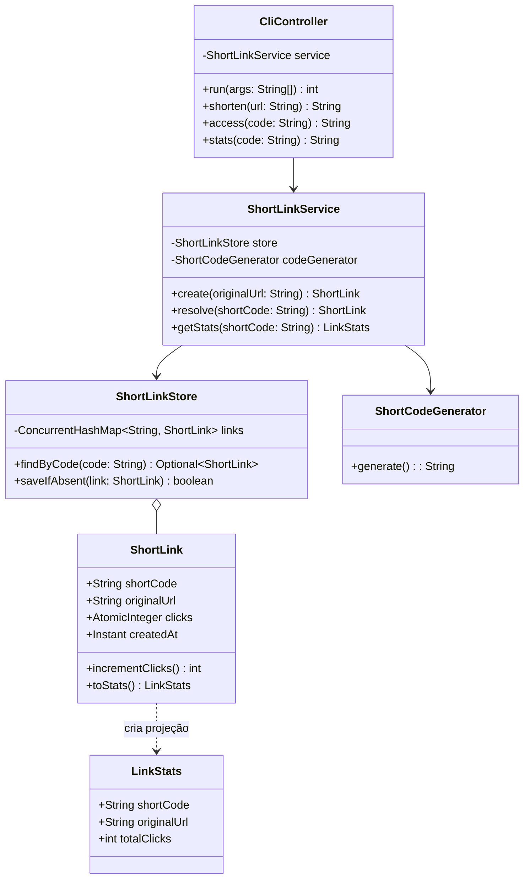
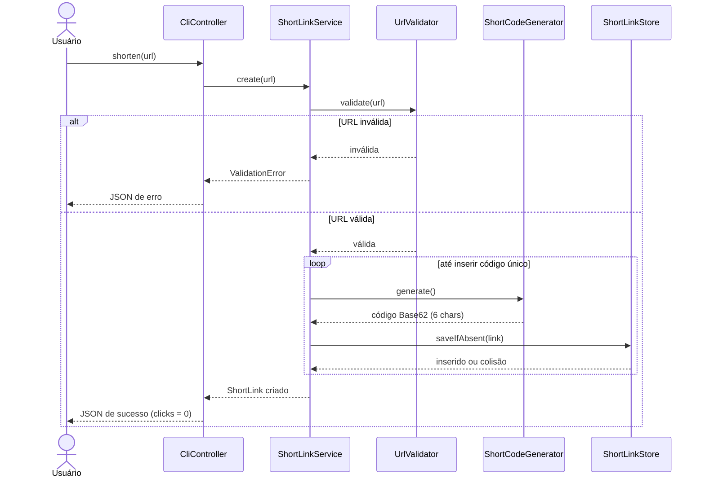
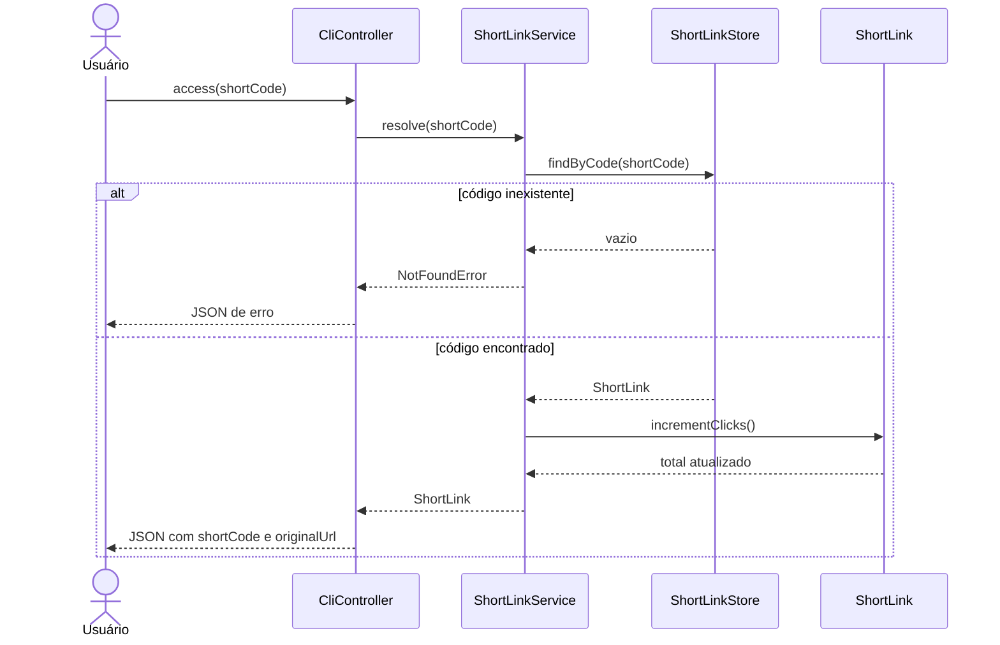

# Arquitetura MVP — Encurtador de URLs

## Escopo e decisões

Implementação em Java 17+ com Spring Boot, execução via CLI e respostas JSON. O estado vive apenas na RAM; reiniciar a aplicação apaga os registros. O fluxo de acesso resolve o código e incrementa cliques, sem redirecionamento HTTP. Busca e gravação usam mapa concorrente; o contador é atômico.

## Casos de uso

### Criar link curto

- Entrada: URL não vazia com protocolo `http://` ou `https://`.
- Validar sintaxe e protocolo; URL inválida retorna envelope de erro JSON e não altera o armazenamento.
- Gerar código de seis caracteres Base62. Em colisão, gerar novamente; nunca sobrescrever registro existente.
- Armazenar código, URL original, cliques inicializados em zero e instante `createdAt` ISO-8601.
- Saída: envelope de sucesso com `shortCode`, `originalUrl`, `clicks: 0` e `createdAt`.

### Acessar link

- Entrada: código curto de seis caracteres.
- Se encontrado, incrementar `clicks` atomicamente uma vez e retornar envelope de sucesso com `shortCode` e `originalUrl` em JSON (status 200; sem redirect).
- Se ausente, retornar envelope de erro JSON “Código curto não encontrado.” sem alterar contadores.

### Ver estatísticas

- Entrada: código curto.
- Se encontrado, retornar `shortCode`, `originalUrl` e `totalClicks` sem incrementar o contador.
- Se ausente, retornar envelope de erro JSON “Código curto não encontrado.”

## Modelo de domínio



`saveIfAbsent` deve usar inserção condicional atômica (`putIfAbsent`) para evitar sobrescrita em colisões concorrentes. A geração tenta novamente quando a inserção falha.

## Fluxos

### Criar link curto



### Acessar link



## Contratos da CLI e funções

A interação é terminal/CLI, não API HTTP. Os nomes abaixo são contratos sugeridos; o formato JSON segue os envelopes definidos nos requisitos (`status`, `data` ou `message`).

| Operação | Contrato sugerido | Resultado |
|---|---|---|
| Iniciar CLI | `int run(String[] args)` | Lê comandos até sair; imprime JSON por operação. |
| Criar | `String shorten(String url)` | JSON com `shortCode`, `originalUrl`, `clicks`, `createdAt`. |
| Acessar/resolver | `String access(String shortCode)` | JSON com `shortCode`, `originalUrl`; soma um clique em sucesso. |
| Estatísticas | `String stats(String shortCode)` | JSON com `shortCode`, `originalUrl`, `totalClicks`; leitura não incrementa. |
| Validar URL | `void validate(String url)` | Aceita somente URL HTTP/HTTPS válida; caso contrário lança erro de validação. |
| Gerar código | `String generate()` | Gera exatamente seis caracteres Base62. |
| Procurar registro | `Optional<ShortLink> findByCode(String code)` | Busca em memória em O(1) esperado. |
| Inserção única | `boolean saveIfAbsent(ShortLink link)` | Inserção condicional sem sobrescrita. |
| Resolver serviço | `ShortLink resolve(String shortCode)` | Procura e incrementa atomicamente; erro se ausente. |
| Obter estatísticas | `LinkStats getStats(String shortCode)` | Projeta métricas sem alterar o contador. |

CLI pode oferecer comandos `shorten <url>`, `access <code>`, `stats <code>` e `exit`. Para evitar ambiguidade de parsing, cada comando produz um único objeto JSON em stdout; erros também usam JSON padronizado. A escolha entre modo interativo e argumentos por execução fica como detalhe de implementação, preservando esses quatro comandos.

## Estrutura de pastas sugerida

```text
src/main/java/<pacote>/
  ShortenerApplication.java
  cli/
    CliController.java
    JsonOutput.java
  domain/
    ShortLink.java
    LinkStats.java
  service/
    ShortLinkService.java
    UrlValidator.java
    ShortCodeGenerator.java
  store/
    ShortLinkStore.java

src/test/java/<pacote>/
  service/
    ShortLinkServiceTest.java
  cli/
    CliControllerTest.java
```

A camada `cli` interpreta comandos e serializa envelopes; `service` concentra regras; `domain` contém os dados; `store` mantém o `ConcurrentHashMap`. `src/test` é uma sugestão de organização para o desenvolvedor, sem criar testes ou arquivos de código nesta etapa.

## Tarefas do MVP

- [READY_FOR_DEV] Criar esqueleto Spring Boot Java 17+ e configuração de inicialização CLI (`int run(String[] args)`).
- [READY_FOR_DEV] Definir `ShortLink` e `LinkStats`, com timestamps ISO-8601 e contador `AtomicInteger` inicializado em zero.
- [READY_FOR_DEV] Implementar `ShortLinkStore.findByCode(String): Optional<ShortLink>` e `saveIfAbsent(ShortLink): boolean` com `ConcurrentHashMap` e `putIfAbsent`.
- [READY_FOR_DEV] Implementar `UrlValidator.validate(String): void` para validar URL absoluta com protocolo HTTP/HTTPS.
- [READY_FOR_DEV] Implementar `ShortCodeGenerator.generate(): String` para código Base62 de seis caracteres.
- [READY_FOR_DEV] Implementar `ShortLinkService.create(String): ShortLink`, incluindo validação, criação de timestamp e repetição em colisão.
- [READY_FOR_DEV] Implementar `ShortLinkService.resolve(String): ShortLink`, incrementando atomicamente somente quando o código existe.
- [READY_FOR_DEV] Implementar `ShortLinkService.getStats(String): LinkStats`, sem incremento; código inexistente gera erro de domínio.
- [READY_FOR_DEV] Implementar comandos CLI `shorten <url>`, `access <code>`, `stats <code>`, `exit` e serialização dos envelopes JSON de sucesso e erro.
- [READY_FOR_DEV] Verificar manualmente critérios de aceite: URL inválida, colisão, código ausente, incremento em acesso e estatísticas sem incremento.

## Fora do escopo

Persistência em disco/banco, autenticação, expiração, redirecionamento HTTP, customização de códigos, relatórios agregados e interface gráfica.
